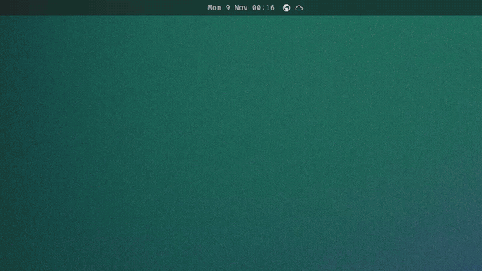
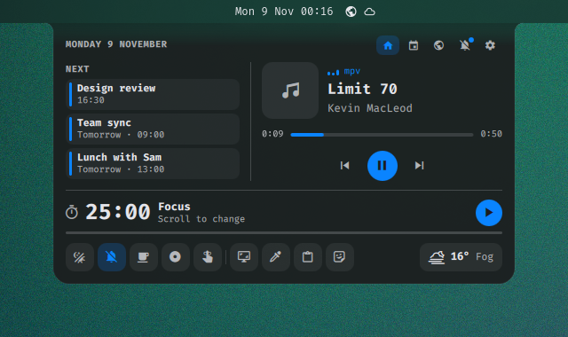

<p align="left">
  <a href="https://thealejandro.dev">
    <picture>
      <source media="(prefers-color-scheme: dark)" srcset="docs/marca/logotipo-oscuro.svg">
      
    </picture>
  </a>
</p>

# omarchy-island

[English](README.md)

Una isla dinámica para [Omarchy](https://omarchy.org) que sale de la barra
de Omarchy, justo donde está el reloj, en el borde que tenga la barra.
Muestra lo que suena, te da controles de música, un calendario con tu
propia agenda, la hora en el mundo, el clima con pronóstico de 3 días, un
temporizador de enfoque, acciones rápidas y los toggles de Omarchy, y se
aparta cuando terminas. Todo se configura desde una página de ajustes dentro
de la isla.

Es un plugin normal del shell de Omarchy: corre dentro de `omarchy-shell`,
toma los colores, la fuente y el acento de tu tema y no reemplaza ni modifica
nada de Omarchy. Si lo quitas, tu escritorio queda exactamente como estaba.

<p align="center">
  
</p>

| Abierta | Vistazo |
| --- | --- |
|  |  |

## Funciones

- **Vistazo**: cuando cambia la canción, termina el temporizador, conectas o
  desconectas el portátil, o la batería baja (20 % y 10 %), una línea baja de
  la barra unos segundos.
- **Volumen y brillo en la isla** (opcional): el OSD de Omarchy (volumen,
  brillo, micrófono, luz del teclado, teclas multimedia) aparece como un
  vistazo con su barra de nivel en lugar de una tarjeta flotante. Ver `osd`
  abajo.
- **Abrir**: pasa el ratón por el reloj de la barra, o justo debajo (o usa
  un atajo), y se abre la isla: portada,
  reproductor, título, artista, barra de progreso que puedes pulsar o
  arrastrar, anterior / reproducir / siguiente.
- **Páginas**: la isla abierta tiene cuatro, en las pestañas de su esquina:
  Inicio (todo lo de abajo), Calendario, Mundo y Ajustes.
- **Calendario y agenda**: el mes con hoy resaltado y un punto en los días
  con algo. Las flechas o la rueda del ratón cambian de mes; pulsa el título
  para volver a hoy. La página Calendario lista el día elegido: tus eventos
  (añadir, editar, repetir semanal/mensual/anual), los recordatorios de
  Omarchy y lo que viene en la próxima semana. La isla te avisa antes de un
  evento (vistazo y notificación) o lo pasa a `omarchy reminder` con un
  clic. Ver [Agenda](#agenda).
- **Mundo y clima**: las ciudades del widget elsewhen de Omarchy como
  chips en Inicio y una lista completa en la página Mundo (hora, día,
  diferencia con aquí), más el clima con pronóstico de 3 días. Ver
  [Hora mundial y clima](#hora-mundial-y-clima).
- **Página de ajustes**: todos los ajustes de abajo, con interruptores,
  opciones y botones +/−. Los cambios se guardan al momento en `shell.json`
  y lo que cambies por línea de comandos aparece ahí en vivo.
- **Temporizador de enfoque**: Pomodoro (25 / 5 por defecto) con una
  notificación al terminar cada fase. Usa la rueda sobre el temporizador
  para cambiar la duración del enfoque (5–120 min).
- **Dock**: una fila fina en la parte de abajo.
  - Toggles rápidos: luz nocturna, silenciar notificaciones, mantener
    despierto, grabar pantalla y recordatorios, los mismos interruptores que
    los indicadores de la barra de Omarchy. Un botón iluminado está activo.
  - Acciones: captura de pantalla, cuentagotas, historial del portapapeles y
    selector de emojis. La isla se aparta antes de que empiecen.
  - Clima: icono, temperatura y estado del lugar configurado en el widget de
    clima de Omarchy (o por IP), desde wttr.in. Púlsalo para ver el
    pronóstico de Omarchy.
  - Pasa el ratón por un botón para ver su nombre.
- **Sin toggles duplicados**: con la isla en la barra (ver abajo), pasar el
  ratón por el centro de la barra ya no muestra los indicadores inactivos de
  Omarchy; la barra deja solo los que están activos. Configurable.
- **Español e inglés**: sigue `LANG`, o elígelo en `shell.json`.
- **Sigue tu tema**: cambia en vivo con `omarchy theme set` (colores, fuente
  y acento). La isla tiene esquinas redondeadas con "orejas" cóncavas que se
  funden con la barra, y un contorno muy sutil (algo más marcado en temas
  claros). Un tema puede ajustarlo en su `shell.toml`: `[island]` `border`,
  `border-alpha`, `border-width`.
- **Ligera**: sin procesos extra. La música llega por MPRIS (Spotify,
  navegadores, mpv…); lo único que se consulta solo es el clima, cada 20
  minutos, los husos de la hora mundial mientras la isla está abierta y
  `agendaCommand` si lo configuras.

## Novedades

La versión 0.5.0 abre la isla en cualquier borde y sobre el reloj real,
añade las páginas Calendario (con agenda y recordatorios), Mundo (hora
mundial y pronóstico) y Ajustes, y deja clicables elsewhen y el clima con la
isla abierta. El detalle está en [CHANGELOG.md](CHANGELOG.md) (en inglés).

## Requisitos

Omarchy 4 o posterior (`omarchy-shell` basado en Quickshell; probado en
4.0.0.alpha). La barra puede estar en cualquier borde: arriba, abajo,
izquierda o derecha. Con una versión de Omarchy con la que la isla no se ha
probado, su página de ajustes lo indica; lo que no encuentre pasa a un
comportamiento más simple en lugar de romperse (ver
[Compatibilidad](#compatibilidad)).

## Instalación

```bash
omarchy plugin add https://github.com/thealejandro/omarchy-island.git --enable
```

Después ponla en la barra junto al reloj. Ahí no ocupa sitio; sirve para
ocultar los indicadores que la isla ya lleva, y es como la isla encuentra el
reloj en la barra para colgar exactamente de él:

```bash
omarchy bar put thealejandro.island --after omarchy.clock
```

Para quitarla cuando quieras:

```bash
omarchy plugin remove thealejandro.island
```

## Uso

- Pasa el ratón por el reloj de la barra, o por la franja fina junto a él,
  para abrir la isla; al alejarte se cierra. Se abre sobre el reloj esté
  donde esté (centro, izquierda, derecha) y en el borde que tenga la barra.
- Pulsa el reloj para fijar la isla abierta; vuelve a pulsar para cerrarla.
  Con `clockClick` ese clic puede abrir la página Calendario o dejar el reloj
  al calendario de Omarchy. El clic derecho sigue cambiando el formato del
  reloj y el central sigue abriendo el menú de zonas horarias.
- Con la isla abierta, los demás widgets de la barra (elsewhen, clima…)
  siguen siendo clicables y sus paneles se abren encima.
- Elige página en las pestañas de la esquina. Un clic en un día del
  calendario pequeño abre la página Calendario en ese día.
- Para abrirla con una tecla, en `~/.config/hypr/bindings.lua`:

  ```lua
  o.bind("SUPER + I", "Island", "omarchy-shell island toggle")
  ```

IPC (`omarchy-shell island <método>`):

| Método        | Efecto                                          |
|---------------|-------------------------------------------------|
| `toggle`      | Fija la isla abierta / cerrada                  |
| `open`        | La fija abierta                                 |
| `close`       | La cierra                                       |
| `page <nombre>` | La abre en `home`, `calendar`, `world` o `settings` |
| `peek`        | Muestra el vistazo                              |
| `timer`       | Inicia / pausa el temporizador                  |
| `focus <min>` | Duración del enfoque (con el temporizador parado, 5–120) |
| `event <fecha> <hora> <título>` | Añade un evento (`2026-11-20 09:30 "Dentista"`; hora `""` para todo el día) |
| `events <fecha>` | JSON con los eventos de ese día (`""` para hoy) |
| `anchor <pantalla> <centro> <largo>` | De dónde colgar, para barras que no se lo pueden decir a la isla |
| `anchors`     | JSON con el borde de la barra y las anclas en uso |
| `state`       | JSON con el estado actual                       |

## Ajustes

Todo está en la página Ajustes de la isla. Los valores viven en la entrada
de la isla en `~/.config/omarchy/shell.json` (en el layout de la barra, o en
`plugins` si no la pusiste en la barra); solo se escribe lo que cambias:

```json
{ "id": "thealejandro.island", "language": "es", "defaultPage": "calendar" }
```

O por línea de comandos: `omarchy bar set thealejandro.island toggles both`
(listas y `null` con `--json`). **Restablecer**, en la sección Sistema,
quita solo las claves propias de la isla.

| Clave | Valores | Por defecto | Qué hace |
|-------|---------|-------------|----------|
| `language` | `en`, `es` | según `LANG` | Idioma de la isla |
| `defaultPage` | `home`, `calendar`, `world` | `home` | Página con la que se abre |
| `calendarFirst` | `true`, `false` | `false` | Calendario a la izquierda en Inicio |
| `showMedia`, `showTimer`, `showDock`, `showWorld` | `true`, `false` | `true` | Partes de la página Inicio |
| `openWidth` | 420–800 | `560` | Ancho de la isla abierta |
| `blur` | `true`, `false` | `true` | Desenfoque detrás de la isla con la barra de cristal |
| `clock` | `true`, `false` | `true` | Abrir al pasar sobre el reloj (`false`: solo la franja del borde) |
| `clockClick` | `pin`, `calendar`, `omarchy` | `pin` | Clic en el reloj: fijar la isla, abrirla en el calendario o el calendario de Omarchy |
| `anchor` | `clock`, `widget`, `center` | `clock` | Colgar del reloj de Omarchy, del sitio de la isla en la barra o del centro |
| `clockWidth` | 60–400 | `120` | Zona de hover si no se encuentra el reloj |
| `hoverOpen` | `true`, `false` | `true` | Abrir al pasar el puntero |
| `hoverDelay` | 0–600 ms | `120` | Espera antes de abrir al pasar |
| `peekDuration` | 1000–10000 ms | `3500` | Duración de un vistazo |
| `toggles` | `island`, `both`, `bar` | `island` | Dónde viven los toggles de Omarchy |
| `widgetIcon` | `true`, `false` | `false` | Un botón propio pequeño en la barra |
| `units` | `metric`, `imperial` | `metric` | Unidades del clima |
| `forecast` | `true`, `false` | `true` | Pronóstico de 3 días en Mundo |
| `hour24` | `true`, `false` | el de elsewhen, si no el del idioma | Hora mundial en 24 h |
| `cities` | `[{"name","zone"}]` | las de elsewhen | Lista de ciudades propia |
| `weekStart` | 1 (lun) – 7 (dom) | el del idioma | Primer día de la semana |
| `reminderLead` | 0–120 min | `10` | Aviso antes de un evento |
| `agendaCommand` | comando | `""` | Eventos extra de otro calendario |
| `osd` | `true`, `false` | `false` | Mostrar el OSD de Omarchy en la isla |
| `battery` | `true`, `false` | `true` | Vistazos de carga y batería baja |

`toggles` decide dónde viven los toggles rápidos de Omarchy:

- `island`: en la isla; la barra muestra solo los indicadores activos.
- `both`: en la isla, y la barra sigue mostrándolos todos al pasar el ratón
  por su centro (el comportamiento de Omarchy).
- `bar`: solo en la barra; el dock de la isla mantiene las acciones y el
  clima.

`osd` hace que la isla muestre el OSD de Omarchy. Solo un plugin puede ser
el dueño, así que la tarjeta de Omarchy tiene que apartarse. El botón
**Usar como OSD** de la sección Sistema hace los dos pasos; a mano:

```bash
omarchy plugin disable omarchy.osd
omarchy bar set thealejandro.island osd true
```

Para volver: `omarchy bar set thealejandro.island osd false` y
`omarchy plugin enable omarchy.osd` (o el mismo botón otra vez).

`battery: false` silencia los vistazos de carga y batería baja. En equipos
sin batería nunca aparecen.

## Agenda

Tus eventos se guardan en `~/.local/state/omarchy/island/events.json`,
aparte de `shell.json` (son datos, no ajustes). La isla lo escribe de forma
atómica y recoge lo que edites a mano:

```json
{
  "version": 1,
  "events": [
    { "id": "e1", "date": "2026-11-20", "time": "09:30", "title": "Dentista",
      "repeat": "none", "remind": null }
  ]
}
```

`time` es `""` para un evento de todo el día; `repeat` es `none`, `weekly`,
`monthly` o `yearly`; `remind` son minutos antes, o `null` para usar
`reminderLead`. En ese momento la isla se asoma y manda una notificación.
La campana de un evento de hoy lo pasa a los recordatorios de Omarchy
(`omarchy reminder <minutos> "<título>"`), y los recordatorios activos de
Omarchy aparecen en hoy.

**Otros calendarios.** `agendaCommand` ejecuta un comando al arrancar la
isla y cada 15 minutos; cada línea que imprima como
`AAAA-MM-DD<TAB>HH:MM<TAB>título` (hora vacía para todo el día) aparece como
un evento de solo lectura. Por ejemplo con
[khal](https://github.com/pimutils/khal) (comprueba las opciones de formato
de tu versión de khal):

```bash
omarchy bar set thealejandro.island agendaCommand "khal list --format '{start-date}\t{start-time}\t{title}' --day-format '' today 14d"
```

## Hora mundial y clima

La página Mundo y los chips de Inicio usan las ciudades del widget elsewhen
de Omarchy, leídas de su entrada en `shell.json`, así mantienes una sola
lista. Pon `cities` para darle a la isla la suya (`Nombre|Zona/Ciudad, …`
en la página de ajustes). La isla calcula las horas a partir del desfase de
cada zona (`TZ=zona date`), así que no necesita elsewhen en la barra; si
está, un clic en un chip abre su panel. Sin ciudades no hay fila de mundo.

El clima es el mismo parte de wttr.in de la píldora del dock, para el lugar
configurado en el widget de clima de Omarchy (o por IP), cada 20 minutos.
**Abrir pronóstico** abre el panel del clima de Omarchy (si el widget está
en la barra) y **Cambiar ubicación** su selector de lugar, o el archivo que
lee.

## Compatibilidad

La isla solo usa lo que Omarchy ofrece a un plugin, y lo comprueba en lugar
de darlo por hecho:

- El borde y el tamaño de la barra vienen de la API de barra para plugins;
  sin ella, de `shell.json` y del tema. Con la barra oculta la isla se abre
  en el borde de la pantalla.
- El reloj se busca entre los widgets de la barra (`omarchy.clock`). Si una
  barra futura cambia eso, la isla cuelga de su propio sitio en la barra
  (como `anchor: widget`) o del centro.
- Los ajustes se guardan con `updateEntryInline` de la API de plugins, o con
  `omarchy bar set` si falta.
- Nunca escribe archivos de Omarchy; solo su entrada en `shell.json` (y
  `disabledPlugins` mediante `omarchy plugin` cuando le pides usar el OSD) y
  `~/.local/state/omarchy/island/`.

### Problemas frecuentes

- *La isla se abre en el centro de la barra, no sobre el reloj*: pon la isla
  en la barra (`omarchy bar put thealejandro.island --after
  omarchy.clock`) o revisa `omarchy-shell island anchors`.
- *`osd: true` pero no hay OSD en la isla*: `omarchy.osd` de Omarchy sigue
  habilitado; usa el botón de la sección Sistema.
- *No hay fila de mundo*: elsewhen no tiene ciudades (o está deshabilitado) y
  `cities` está vacío.
- *Una barra de terceros*: sin la API de barra de Omarchy la isla usa
  `shell.json`; la barra puede indicar el reloj con `omarchy-shell island
  anchor <pantalla> <centro> <largo>`.

## Desarrollo

Clónalo donde quieras y enlázalo en la carpeta de plugins:

```bash
git clone https://github.com/thealejandro/omarchy-island.git
ln -s "$PWD/omarchy-island" ~/.config/omarchy/plugins/thealejandro.island
omarchy-shell shell rescanPlugins
omarchy plugin enable thealejandro.island
```

Quickshell guarda en caché el QML compilado: después de editar el código,
ejecuta `omarchy restart shell` para ver los cambios.

| Archivo            | Qué hace                                               |
|--------------------|--------------------------------------------------------|
| `Service.qml`      | Estado: reproductor MPRIS, temporizador, toggles, clima, mundo, agenda, OSD, batería, ajustes, anclas, IPC |
| `BarWidget.qml`    | Entrada en la barra: oculta indicadores duplicados, encuentra el reloj, botón opcional |
| `IslandSettings.js` | Esquema de ajustes: valores por defecto, normalización, guardado, esquema del manifest |
| `IslandGeometry.js` | Bordes de la barra, posición a lo largo de ella, búsqueda del reloj |
| `IslandModel.js`   | Funciones puras: elegir reproductor, reloj, textos, mes, clima, horas del mundo |
| `AgendaModel.js`   | Funciones puras de eventos: repeticiones, próximos, avisos, líneas externas |
| `IslandWindow.qml` | Capa por pantalla, máscara de entrada, hover, animación |
| `IslandShape.qml`  | La silueta con orejas cóncavas, girada al borde de la barra |
| `PeekView.qml`     | El vistazo de una línea: canción, temporizador, OSD, batería o evento |
| `OpenView.qml`     | Cabecera, pestañas y página actual                     |
| `HomePage.qml`     | La página de inicio                                    |
| `CalendarPage.qml`, `AgendaList.qml`, `EventEditor.qml` | Página de calendario y agenda |
| `WorldPage.qml`, `WorldRow.qml` | Página Mundo y los chips de Inicio        |
| `SettingsView.qml`, `PageTabs.qml` | Página de ajustes y pestañas         |
| `IslandToggle.qml`, `IslandSegment.qml`, `IslandStepper.qml`, `IslandField.qml` | Controles de los ajustes |
| `MediaCard.qml`    | Portada, canción, barra de progreso y controles        |
| `CalendarView.qml` | Calendario del mes                                     |
| `TimerRow.qml`     | Temporizador de enfoque                                |
| `Dock.qml`         | Fila de toggles, acciones y clima                      |
| `IslandButton.qml` | Botón redondo con icono                                |
| `Glyph.qml`        | Icono centrado por su tinta, no por su caja            |
| `Equalizer.qml`    | Barritas animadas mientras suena música                |

Ideas y fallos, en los issues. Inspirado en
[Nusa](https://rama2555.github.io/nusa/) para Windows y en el notch de
[Ambxst](https://github.com/Axenide/Ambxst); no se ha tomado código de
ninguno.

## Licencia

MIT

---

Hecho por [thealejandro](https://thealejandro.dev).
