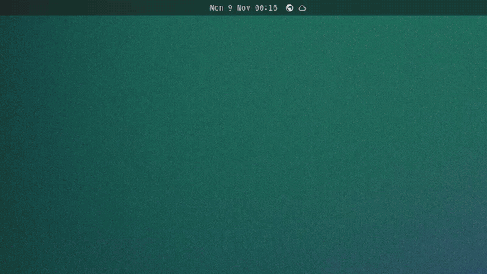
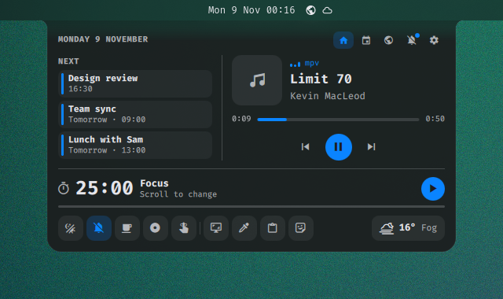
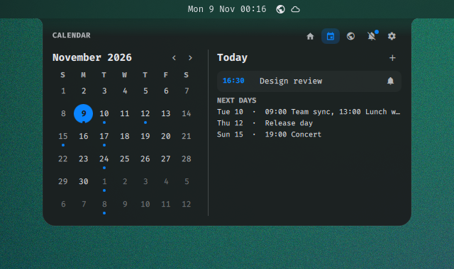
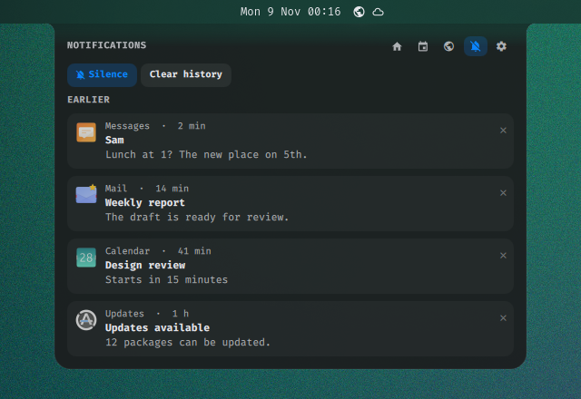
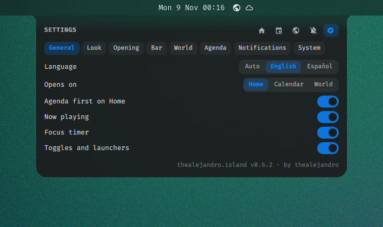
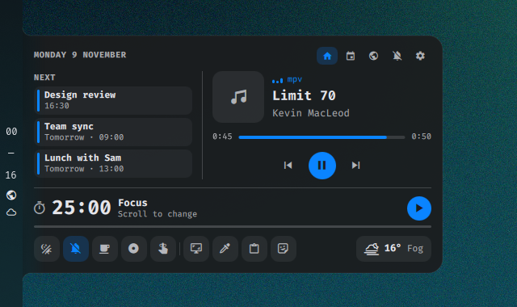
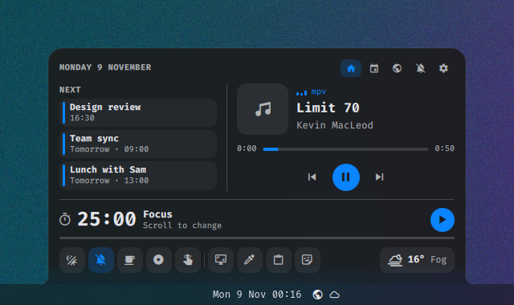

<p align="left">
  <a href="https://thealejandro.dev">
    <picture>
      <source media="(prefers-color-scheme: dark)" srcset="docs/marca/logotipo-oscuro.svg">
      
    </picture>
  </a>
</p>

# omarchy-island

[Español](README.es.md)

A dynamic island for [Omarchy](https://omarchy.org) that grows out of the
Omarchy bar, right where the clock is, on whichever edge the bar sits. It
shows what's playing, gives you media controls, your notifications (if you
want them there), a calendar with your own agenda, the time around the world, the weather with a 3-day forecast, a focus
timer, quick actions and Omarchy's quick toggles, and gets out of the way when
you're done. Everything is configurable from a settings page inside the
island.

It is a regular Omarchy shell plugin: it runs inside `omarchy-shell`, takes
its colors, font and corner radius from your current theme, and doesn't
replace or modify anything in Omarchy. Remove it and your desktop is exactly
as it was.

<p align="center">
  
</p>

| Home | Peek |
| --- | --- |
|  |  |
| **Calendar** | **Notifications** |
|  |  |
| **Settings** | **Bar on the left** |
|  |  |
| **Bar at the bottom** | |
|  | |

## Features

- **Peek**: when the song changes, the timer ends, you plug in or unplug a
  laptop, or the battery runs low (20% and 10%), a one-line glance drops out
  of the bar for a few seconds.
- **Volume and brightness in the island** (optional): Omarchy's OSD (volume,
  brightness, mic mute, keyboard light, media keys) shows up as a peek with
  a level bar instead of a floating card. See `osd` below.
- **Notifications in the island** (optional, off by default): new
  notifications drop out of the bar as a glance, and a Notifications page
  keeps them grouped by app, with their actions, replies and links, plus a
  24-hour history. Omarchy's cards step aside while it's on, so nothing
  shows twice. See [Notifications](#notifications).
- **Open**: hover the bar's clock, or just below it (or bind a key), to open
  the island: cover art, source player,
  title, artist, a progress bar you can click or drag, previous / play /
  next.
- **Pages**: the open island has five, picked from the tabs in its top
  corner: Home, Calendar, World, Notifications and Settings.
- **Home**: what's playing next to **Next** (the next three events of
  your agenda, with a button to add one), the latest notifications when the
  island has them, the focus timer and the dock.
- **Calendar and agenda**: the month with today highlighted and a dot on
  days that have something. Arrows or the scroll wheel change month; click
  the title to go back to today. The Calendar page lists the picked day:
  your own events (add, edit, repeat weekly/monthly/yearly), Omarchy's
  reminders and what's coming in the next week. The island reminds you
  before an event (a peek and a notification), or hands the event to
  `omarchy reminder` with one click. See [Agenda](#agenda).
- **World and weather**: the cities from Omarchy's elsewhen widget on the
  World page (time, day, difference from here), plus the weather with a
  3-day forecast. A click on the world clock or the weather on the bar
  opens it. See
  [World clock and weather](#world-clock-and-weather).
- **Settings page**: every setting below, with switches, choices and steppers.
  Changes are saved to `shell.json` at once and anything set from the
  command line shows up there live.
- **Focus timer**: Pomodoro (25 / 5 by default) with a notification when each
  phase ends. Scroll over the timer to change the focus length (5–120 min).
- **Dock**: one slim row along the bottom.
  - Quick toggles: night light, silence notifications, stay awake, screen
    recording and reminders, the same switches as Omarchy's bar indicators.
    A lit button is on.
  - Actions: screenshot, color picker, clipboard history and emoji picker.
    The island steps aside before they start.
  - Weather: icon, temperature and conditions for the place set in Omarchy's
    weather widget (or by IP), from wttr.in. Click it for Omarchy's forecast.
  - Hover a button to see its name.
- **No duplicate toggles**: with the island on the bar (see below), hovering
  the bar's center no longer reveals Omarchy's inactive indicators; the bar
  keeps only the ones that are on. Configurable.
- **English and Spanish**: follows `LANG`, or set it in `shell.json`.
- **Theme-aware**: follows `omarchy theme set` live: colors, font and accent.
  The island keeps rounded corners with concave "ears" that melt into the
  bar, and a very subtle outline (a little stronger on light themes). A theme
  can tune it in its `shell.toml`: `[island]` `border`, `border-alpha`,
  `border-width`.
- **Motion**: the island opens on a spring, and pages and glances slide in
  briefly; transforms and opacity only. `animations: false` turns all of it
  off.
- **Light**: no extra process. Media comes from MPRIS (Spotify, browsers,
  mpv…); the only polling is the weather, every 20 minutes, the world
  clock's time zones while the island is open, and `icsSources` and
  `agendaCommand` if you set them. A closed island holds no pages, cover art or icons. See
  [Performance](#performance).

## Requirements

Omarchy 4 or newer (Quickshell-based `omarchy-shell`; tested on
4.0.0.alpha). The bar can be on any edge: top, bottom, left or right. On an
Omarchy version the island wasn't tested with, its settings page says so;
anything it can't find degrades to a simpler behavior instead of breaking
(see [Compatibility](#compatibility)).

## Install

```bash
omarchy plugin add https://github.com/thealejandro/omarchy-island.git --enable
```

Then put it on the bar next to the clock. It takes no room there; it lets
the island hide the indicators it already carries, and it's how the island
finds the clock on the bar to hang from it exactly:

```bash
omarchy bar put thealejandro.island --after omarchy.clock
```

Remove it any time. If the island had Omarchy's notifications or OSD,
Omarchy gets them back on its own a few seconds later (also when you just
disable it):

```bash
omarchy plugin remove thealejandro.island
```

If the island folder was deleted by hand while the shell wasn't running,
give them back yourself:

```bash
omarchy plugin enable omarchy.notifications; omarchy plugin enable omarchy.osd
```

## Usage

- Hover the bar's clock, or the thin strip next to it, to open the island;
  move away and it closes. It opens over the clock wherever the clock is
  (center, left, right) and on whatever edge the bar is.
- Click the clock to open the island on the Calendar page; click again to
  close it. With `clockClick` you can make that click just pin the island
  open on its page, or leave the clock to Omarchy's own calendar. Right
  click still changes the clock format and middle click still opens the
  timezone menu.
- Click Omarchy's world clock (elsewhen) or weather on the bar to open the
  island on the World page instead of their popups (`barClicks`). Middle
  click still opens their own popup, and right click does what it does on
  the widget (refresh, or the weather as a notification). Hovering them
  doesn't open the island.
- With the island open, the bar's other widgets stay clickable and their
  panels open on top of it.
- Pick a page from the tabs in the top corner. A click on a day of the
  small calendar opens the Calendar page on that day.
- With the island pinned, the keyboard works too: click it (or run
  `omarchy-shell island keyboard`) and Tab walks its tabs, buttons and
  settings with a visible ring, Space or Enter presses, ←/→ change page,
  section or choice and step numbers, and Esc closes it. Hovering it open
  never takes the keyboard from your window. Every icon button has a name
  for screen readers. Off with `keyboard: false`.
- Toggle it from a key, in `~/.config/hypr/bindings.lua`:

  ```lua
  o.bind("SUPER + I", "Island", "omarchy-shell island toggle")
  ```

IPC (`omarchy-shell island <method>`):

| Method   | Effect                                   |
|----------|------------------------------------------|
| `toggle` | Pin the island open / closed             |
| `open`   | Pin it open                              |
| `close`  | Close it                                 |
| `keyboard` | Pin it open and take the keyboard (Tab to move, Esc to leave); again lets go |
| `page <name>` | Open it on `home`, `calendar`, `world`, `notifications` or `settings` |
| `notifications <island\|off>` | Take Omarchy's notifications or give them back (see [Notifications](#notifications)) |
| `peek`   | Show the short glance                    |
| `timer`  | Start / pause the focus timer            |
| `focus <min>` | Set the focus length (idle timer, 5–120) |
| `event <date> <time> <title>` | Add an event (`2026-11-20 09:30 "Dentist"`; time `""` for all day) |
| `events <date>` | JSON with that day's events (`""` for today) |
| `anchor <screen> <center> <length>` | Where to hang from, for bars that can't tell the island themselves |
| `anchors` | JSON with the bar edge and the anchors in use |
| `state`  | JSON with the current state              |

## Settings

Everything is on the island's Settings page. The values live in the
island's entry in `~/.config/omarchy/shell.json` (in the bar layout, or
under `plugins` if you didn't put it on the bar); only what you change is
written there:

```json
{ "id": "thealejandro.island", "language": "es", "defaultPage": "calendar" }
```

Or from the command line: `omarchy bar set thealejandro.island toggles both`
(lists and `null` with `--json`). **Reset** on the System section removes
the island's own keys and nothing else.

| Key | Values | Default | What it does |
|-----|--------|---------|--------------|
| `language` | `en`, `es` | from `LANG` | Island language |
| `defaultPage` | `home`, `calendar`, `world` | `home` | Page the island opens on |
| `calendarFirst` | `true`, `false` | `false` | What's next on the left on Home |
| `showMedia`, `showTimer`, `showDock` | `true`, `false` | `true` | Parts of the Home page |
| `animations` | `true`, `false` | `true` | Spring, page and glance motion |
| `openWidth` | 420–800 | `560` | Width of the open island |
| `blur` | `true`, `false` | `true` | Blur behind the island with a glassy bar |
| `clock` | `true`, `false` | `true` | Open by hovering the clock (`false`: only the edge strip) |
| `clockClick` | `pin`, `calendar`, `omarchy` | `calendar` | Clock click: pin the island, open it on the calendar, or Omarchy's calendar |
| `barClicks` | `true`, `false` | `true` | A click on the bar's world clock or weather opens the World page |
| `anchor` | `clock`, `widget`, `center` | `clock` | Hang from Omarchy's clock, from the island's own spot on the bar, or the bar's center |
| `clockWidth` | 60–400 | `120` | Hover zone when the clock can't be found |
| `hoverOpen` | `true`, `false` | `true` | Open on hover at all |
| `keyboard` | `true`, `false` | `true` | Walk the pinned island with Tab, Space and the arrows |
| `hoverDelay` | 0–600 ms | `120` | Wait before opening on hover |
| `peekDuration` | 1000–10000 ms | `3500` | How long a peek stays |
| `toggles` | `island`, `both`, `bar` | `island` | Where Omarchy's quick toggles live |
| `widgetIcon` | `true`, `false` | `false` | A small button of its own on the bar |
| `units` | `metric`, `imperial` | `metric` | Weather units |
| `forecast` | `true`, `false` | `true` | 3-day forecast on the World page |
| `hour24` | `true`, `false` | elsewhen's, else the locale | 24-hour world clock |
| `cities` | `[{"name","zone"}]` | elsewhen's | The island's own city list |
| `weekStart` | 1 (Mon) – 7 (Sun) | the locale's | First day of the week |
| `reminderLead` | 0–120 min | `10` | Reminder before an event |
| `icsSources` | folders, `.ics` files, `https://` links (comma-separated) | `""` | Calendars to show (Google, Outlook, iCloud, vdirsyncer…) |
| `icsRefresh` | 5–240 min | `15` | How often those calendars are read again |
| `agendaCommand` | shell command | `""` | Extra events from another calendar |
| `osd` | `true`, `false` | `false` | Show Omarchy's OSD in the island |
| `battery` | `true`, `false` | `true` | Charging and low-battery peeks |
| `notifications` | `off`, `island` | `off` | Show notifications in the island instead of Omarchy's cards |
| `notifyBody` | `true`, `false` | `true` | The text in the glance (`false`: app and title only) |
| `notifyPeekDuration` | 2000–15000 ms | `6000` | How long a notification glance stays |
| `notifyHistory` | `true`, `false` | `true` | Keep closed notifications for 24 h |
| `notifyHistoryLimit` | 20–500 | `100` | Closed notifications kept |
| `notifyBadge` | `true`, `false` | `true` | Unread dot under the clock and on the tab |
| `notifyKeyboardIdle` | 3000–30000 | `10000` | Milliseconds without a key before the keyboard mode lets go |

`toggles` decides where Omarchy's quick toggles live:

- `island`: in the island; the bar shows only the indicators that are on.
- `both`: in the island, and the bar still reveals all of them when you hover
  its center (Omarchy's own behavior).
- `bar`: only on the bar; the island's dock keeps the actions and weather.

`osd` makes the island show Omarchy's on-screen display. Only one plugin
can own it, so Omarchy's card has to step aside. The **Use as OSD**
button on the System section does both steps; by hand:

```bash
omarchy plugin disable omarchy.osd
omarchy bar set thealejandro.island osd true
```

To go back: `omarchy bar set thealejandro.island osd false` and
`omarchy plugin enable omarchy.osd` (or the same button again).

`battery: false` silences the charging and low-battery peeks. Desktops
without a battery never show them.

## Notifications

Off by default. With `notifications: island` the island is your
notification server:

- A new notification drops out of the bar as a glance with the app's icon,
  the title and (with `notifyBody`) the text, for `notifyPeekDuration` or
  the sender's own timeout. Critical ones stay until you deal with them.
  Reaching for the glance opens the Notifications page.
- The Notifications page groups them by app, newest first (a browser's
  per site, so WhatsApp Web and GitHub don't share a Chromium group, and
  Omarchy's own toasts each on their own), with their buttons, an inline
  reply when the app offers one, a safe link to open, and a close button
  per notification or per group.
- Clicking a notification does what its sender asked for (its default
  action). When it asked for nothing, the click takes you to the sender:
  its window (by the sending process, or the app's window class), the
  browser tab of the site for web notifications, or else the site's front
  page or the link in the text. The arrow under the close button shows
  the whole text.
- Omarchy's shortcut to handle notifications from the keyboard
  (Super+Ctrl+,) opens the island on its Notifications page and takes the
  keyboard: ↑/↓ (or J/K, Tab) move between cards, Enter does what a click
  does, Delete closes, 1–9 press a button, C copies the card's code and
  Esc leaves. It lets go after `notifyKeyboardIdle` without a key (10 s)
  or when the island closes.
- When a notification brings a one-time code ("Your verification code is
  482913"), its card has a **Copy** button. The code goes to the clipboard
  marked sensitive, so clipboard managers leave it out of their history,
  and it's cleared after a minute if it's still there. Codes are never
  saved with the history. **Silence** is the same
  do-not-disturb as Omarchy's (it's kept in Omarchy's own
  `~/.local/state/omarchy/notifications/quiet.json`), so the bar indicator
  and the dock toggle agree.
- **Earlier** lists closed notifications from the last 24 hours (at most
  `notifyHistoryLimit`), kept in
  `~/.local/state/omarchy/island/notifications.json`, readable only by you.
  Pictures sent over the bus and buttons aren't kept. **Clear history**
  empties it.
- Home shows the latest two, and a dot under the clock and on the tab
  says there's something unread (`notifyBadge`).

Only one program can receive the desktop's notifications, so Omarchy's own
cards have to step aside, the same as with the OSD. The switch on the
System section of Settings does both steps; from a terminal:

```bash
omarchy-shell island notifications island   # the island takes them
omarchy-shell island notifications off      # Omarchy gets them back
```

Both are needed for the island to take over: its setting **and**
`omarchy.notifications` disabled. If Omarchy's plugin is enabled again by
any route (`omarchy plugin enable omarchy.notifications`, a reset, an
Omarchy update), the island steps back at once and Omarchy shows the cards;
Settings then says the island is waiting. If the island is removed or its
setting reset while it had them, Omarchy gets them back the next time the
shell starts. Omarchy's `notifications` IPC (`dismissAll`, `toggleDnd`,
`invokeLast`…) keeps working with the island, so its menu and keybindings
do too.

Notifications that are on screen when the shell restarts are kept as
closed ones in the history; their buttons are gone.

## Agenda

Your events are kept in `~/.local/state/omarchy/island/events.json`, apart
from `shell.json` (they're data, not settings). The island writes it
atomically and picks up edits made by hand:

```json
{
  "version": 1,
  "events": [
    { "id": "e1", "date": "2026-11-20", "time": "09:30", "title": "Dentist",
      "repeat": "none", "remind": null }
  ]
}
```

`time` is `""` for an all-day event; `repeat` is `none`, `weekly`,
`monthly` or `yearly`; `remind` is minutes before, or `null` for
`reminderLead`. At that moment the island peeks and sends a notification.
The bell on an event of today hands it to Omarchy's reminders instead
(`omarchy reminder <minutes> "<title>"`), and Omarchy's active reminders are
listed on today.

**Your calendars (Google, Outlook, iCloud, CalDAV).** `icsSources` takes a
comma-separated list of calendars in iCalendar form, shown read-only next
to your own events (and reminded like them). Each one can be:

- **A private iCal link** (`https://…` or `webcal://…`), fetched every
  `icsRefresh` minutes. Google Calendar: *Settings › your calendar ›
  Integrate calendar › Secret address in iCal format*. Outlook.com /
  Microsoft 365: *Settings › Calendar › Shared calendars › Publish a
  calendar* (the ICS link). iCloud: share the calendar as a *Public
  calendar*. Fastmail, Proton and Nextcloud offer one too.
- **A folder** of `.ics` files, such as the ones
  [vdirsyncer](https://github.com/pimutils/vdirsyncer) keeps in sync from
  any CalDAV server (Nextcloud, Radicale, iCloud, Fastmail, Google via its
  CalDAV support) with `fileext = ".ics"`.
- **An `.ics` file** (an export, a holidays calendar…).

```bash
omarchy bar set thealejandro.island icsSources "~/.local/share/vdirsyncer/calendars, https://calendar.google.com/calendar/ical/…/basic.ics"
```

Treat a private iCal link like a password: anyone who has it can read that
calendar. It stays in your `shell.json`, so leave that file out of public
dotfiles (or use the vdirsyncer folder instead, whose credentials live in
its own config). The island fetches links over HTTPS only and never logs
them. It understands single and repeating events (daily, weekly, monthly,
yearly, with exceptions and moved occurrences), all-day and multi-day
events and time zones, and shows a year either side of today (at most 2000
events). Anything a calendar does that it doesn't understand is left out
rather than shown wrong.

**Other calendars.** `agendaCommand` runs a command when the island starts
and every 15 minutes; each line it prints as
`YYYY-MM-DD<TAB>HH:MM<TAB>title` (empty time for all day) is shown as a
read-only event. For example with [khal](https://github.com/pimutils/khal)
(check the format options of your khal version):

```bash
omarchy bar set thealejandro.island agendaCommand "khal list --format '{start-date}\t{start-time}\t{title}' --day-format '' today 14d"
```

## World clock and weather

The World page uses the cities of Omarchy's elsewhen widget, read from its entry in `shell.json`, so you keep one list. Set
`cities` to give the island its own (`Name|Area/City, …` on the Settings
page). The island works the times out itself from each zone's offset
(`TZ=zone date`), so it doesn't need elsewhen on the bar. Without cities,
the World page shows only the weather.

The weather is the same wttr.in report the dock pill uses, for the place
set in Omarchy's weather widget (or by IP), refreshed every 20 minutes.
**Open forecast** opens Omarchy's weather panel (when the widget is on the
bar) and **Change location** its place picker, or the file it reads.

## Performance

The island runs inside `omarchy-shell`, so what it costs is what the shell
process grows by. Measured on Omarchy 4.0.0.alpha (one 1920×1080 screen at
120 Hz), as the shell's PSS, three interleaved runs each:

| | Shell without the island | 0.5.0 | 0.6.0 |
|---|---|---|---|
| Island closed | ~273 MB | 285 MB | 278 MB |
| Island open (Home) | | 289 MB | 289 MB |
| After visiting every page and closing | | 286 MB | 289 MB* |

\* Memory the views used isn't always handed back to the system right
away; it doesn't grow with more opening and closing (five cycles in a row
stay flat). With `notifications: island` the shell is a few MB lighter
still (closed ~270 MB), since Omarchy's own notifications plugin is
unloaded.

- A closed island keeps no pages, cover art or icons: the open view and the
  glance are built when they're shown and let go a moment after they're
  gone.
- The open view starts being built in the background as soon as the
  pointer reaches the clock, so it's ready when the island opens: the
  first visible frame comes about 24 ms after the island starts opening
  (0.5.0: 25 ms), with no frame over 25 ms while it opens or closes.
- The track position only ticks while music plays and the island is open.

## Compatibility

The island only uses what an Omarchy plugin is offered, and checks for it
instead of assuming it:

- The bar's edge and size come from the plugin bar API; without it, from
  `shell.json` and the theme. A hidden bar is fine: the island opens at the
  screen edge.
- The clock is found by walking the bar's widgets for `omarchy.clock`. If a
  future bar changes that, the island hangs from its own spot on the bar
  (`anchor: widget` behavior) or the center.
- Settings are saved with the plugin API's `updateEntryInline`, or with
  `omarchy bar set` when that's missing.
- It never writes Omarchy's files; only its own entry in `shell.json` (and
  `disabledPlugins` through `omarchy plugin` when you ask it to take over
  the OSD or the notifications), Omarchy's do-not-disturb state through the
  same file Omarchy uses, and `~/.local/state/omarchy/island/`.
- The bar clicks on the world clock and weather need nothing from those
  widgets: the island covers them on the bar and calls their public IPC
  for the middle and right clicks. `barClicks: false` leaves them alone.

### Troubleshooting

- *The island opens in the middle of the bar, not over the clock*: put the
  island on the bar (`omarchy bar put thealejandro.island --after
  omarchy.clock`), or check `omarchy-shell island anchors`.
- *`osd: true` but no OSD in the island*: Omarchy's `omarchy.osd` is still
  enabled; use the button on the System section.
- *No cities on the World page*: elsewhen has no cities (or is disabled)
  and `cities` is empty.
- *Notifications are on but Omarchy's cards still show*: Omarchy's
  `omarchy.notifications` is enabled again (Settings says the island is
  waiting); use the switch on the System section, or `omarchy-shell island
  notifications island`.
- *No notifications at all*: check `omarchy-shell notifications probe`
  (`server` says who has them). `omarchy-shell island notifications off`
  always gives them back to Omarchy.
- *Clicking the weather or world clock opens Omarchy's popup*: put the
  island on the bar (it finds them from there) and keep `barClicks` on.
- *A third-party bar*: without Omarchy's bar API the island falls back to
  `shell.json`; the bar can still report the clock with `omarchy-shell
  island anchor <screen> <center> <length>`.

## Development

Clone anywhere and link it into the plugin directory:

```bash
git clone https://github.com/thealejandro/omarchy-island.git
ln -s "$PWD/omarchy-island" ~/.config/omarchy/plugins/thealejandro.island
omarchy-shell shell rescanPlugins
omarchy plugin enable thealejandro.island
```

Quickshell caches compiled QML, so after editing the code run
`omarchy restart shell` to see the changes.

The pure logic (the `.js` files) has tests that run in Node 22 or newer,
with nothing to install; CI runs them on every pull request:

```bash
node --test 'test/*.test.mjs'
```

| File               | What it does                                         |
|--------------------|------------------------------------------------------|
| `Service.qml`      | State: MPRIS player, timer, toggles, weather, world, agenda, OSD, battery, notifications mode, settings, anchors, IPC |
| `BarWidget.qml`    | Bar entry: hides duplicate indicators, finds the clock, world clock and weather, optional button |
| `NotificationService.qml` | The island's notification server: rows, glances, actions, do-not-disturb, history |
| `NotificationModel.js`, `NotificationSecurity.js` | Pure helpers: notification rows, grouping, history; checks on links, commands and pictures |
| `IslandSettings.js` | The settings schema: defaults, normalizing, saving, manifest schema |
| `IslandGeometry.js` | Bar edges, placement along the bar, finding the clock |
| `IslandModel.js`   | Pure helpers: player choice, clock, strings, month grid, weather, world times |
| `AgendaModel.js`   | Pure helpers for events: repeats, upcoming, reminders, external lines |
| `IslandWindow.qml` | Per-screen layer surface, input mask, hover, bar clicks, motion |
| `IslandShape.qml`  | The silhouette with concave ears, turned to the bar's edge |
| `PeekView.qml`     | The one-line glance: track, timer, OSD, battery, event or notification |
| `OpenView.qml`     | Header, page tabs and the current page               |
| `HomePage.qml`, `TodayCard.qml` | The home page and its "what's next" card |
| `NotificationsPage.qml`, `NotificationGroup.qml`, `NotificationCard.qml`, `NotificationIcon.qml` | Notifications page |
| `CalendarPage.qml`, `AgendaList.qml`, `EventEditor.qml` | Calendar page and agenda |
| `WorldPage.qml`    | World page                                           |
| `SettingsView.qml`, `PageTabs.qml` | Settings page and the page tabs      |
| `IslandToggle.qml`, `IslandSegment.qml`, `IslandStepper.qml`, `IslandField.qml` | Settings controls |
| `MediaCard.qml`    | Cover, track, seek bar and transport                 |
| `CalendarView.qml` | Month calendar                                       |
| `TimerRow.qml`     | Focus timer                                          |
| `Dock.qml`         | Toggles, actions and weather row                     |
| `IslandButton.qml`, `IslandPill.qml` | Round icon button and text pill |
| `Glyph.qml`        | Icon centered by its ink, not its font box           |
| `Equalizer.qml`    | Small animated bars while music plays                |

What changed between versions is in [CHANGELOG.md](CHANGELOG.md).

Ideas and bugs go to the issues. Inspired by
[Nusa](https://rama2555.github.io/nusa/) on Windows and the notch in
[Ambxst](https://github.com/Axenide/Ambxst); no code is taken from either.

## License

MIT

---

Made by [thealejandro](https://thealejandro.dev).
